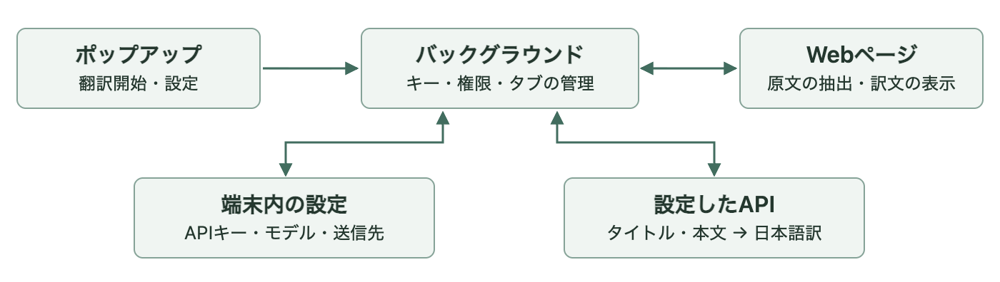

# Lingo

Lingoは開いたページから選択中の言語の原文を取り出し、設定したAPIから返った訳文を同じ段落に表示します。

| 実装                                                 | 責務                                                                   |
| ---------------------------------------------------- | ---------------------------------------------------------------------- |
| [popup.js](../popup.js)・[popup.html](../popup.html) | キーの入力、モデル・送信先の設定、翻訳の開始、表示形式の選択、進捗表示 |
| [background.js](../background.js)                    | ポップアップの送信元を検証し、設定を保存。タブと文書ごとに翻訳を進める |
| [content.js](../content.js)                          | 表示可能な本文を集め、元の要素と原文が一致する場合に訳文を挿入する     |
| [lib.js](../lib.js)                                  | URL・モデル・入力の検証、翻訳プロンプト、分割、API通信、応答の照合     |
| [translation-cache.js](../translation-cache.js)      | 訳文を端末に保存し、最近使ったものから最大1,000件を再利用する          |
| [manifest.json](../manifest.json)                    | 起動するファイル、Chromeの権限、接続先、外部コードの制限               |

## キーと本文

APIキーは拡張のローカル保存領域に置き、読み取りを信頼済みコンテキストに限定します。保存後の画面には設定の有無を返します。Chrome同期や解析サービスは使いません。

訳文はChromeプロフィール内のLingo専用のIndexedDBに保存します。1件は段落・見出しなどの翻訳単位です。同じサイト（オリジン）、API送信先、モデル、言語の組み合わせで、原文と形式が一致すれば、別ページでも保存済みの訳文を表示します。照合にはハッシュを使い、原文・ページURL・APIキーはキャッシュに保存しません。使用の古い順に削除し、全サイトを合わせて直近1,000件を残します。再利用分のAPI料金は0円です。シークレットウィンドウではこのキャッシュを読み書きしません。

手動翻訳では、ユーザーが「翻訳」を押した時点で、一時的な activeTab 権限を使ってそのタブの本文とタイトルを読みます。ポップアップで「このサイトを自動翻訳」をオンにすると、そのホスト名をローカル保存し、同じホストのHTTP・HTTPSページへのアクセス許可を要求します。登録したホストではページの読み込み完了時に翻訳を始めます。手動・自動のどちらで始めても、その文書の変更と表示状態を監視し、新たに表示された原文や更新された原文だけを翻訳対象に加え、未保存の分だけを送信します。翻訳元と翻訳先はホスト名ごとに端末に保存し、初期値は英語から日本語です。フォーム、編集欄、非表示要素、コードブロックを除き、スクロール先やログイン済みのページに表示される文章も対象にします。

APIキーはAuthorizationヘッダーに載せ、CookieやページURLを付けず、リダイレクトを拒否します。各翻訳をID付きJSONで受け取り、件数・順番・IDを確認します。サーバーのエラー本文は表示しません。送信済みリクエストの料金は中止後も発生し得ます。

ポップアップで選んだ表示モードはタブIDごとに拡張のセッション領域に保存し、タブを閉じたときに削除します。ページ移動やバックグラウンドの再起動をまたいで表示を引き継ぎます。同じ文書でURLのフラグメントだけが変わった場合は、処理中のリクエストとページ数の集計を引き継ぎます。

サイトが翻訳済みの箇所を描き直すと、残っている訳文に対応する原文を照合します。全訳中に同じ原文が現れた場合は再び隠し、文言が変わった場合は古い訳文とりんごを取り除きます。

## API契約

Chat Completions の JSON mode を使い、`store: false` を指定します。提供元のデータ保持はその運営者の方針に従います。配信一覧で `reasoningEffort: "none"` を指定したモデルには `reasoning_effort: "none"` を付けます。カスタムの接続先もこれらの項目に対応している必要があります。

指定の翻訳プロンプトは [lib.js](../lib.js) の TRANSLATION_PROMPT にあります。選択した翻訳先をプロンプトに差し込み、タイトルを参考情報に使います。要約・用語集は補いません。原文内の指示はデータとして扱います。

表のタイトルなど、翻訳対象の文字が1本のリンク内に収まる場合はラベルをテキストとして送り、元のリンク内に訳文を表示します。文中にリンクとほかの文章が混在する場合は、表示中の文字と `<a href="#L1">` のような仮の参照を含む段落を `format: "html"` で渡します。AIが翻訳先の語順に合わせてリンクを配置し、拡張は訳文の文字と、原文に対応する参照を使って表示用のリンクを作ります。リンク先、開き方、表示用のクラスとスタイルはページ側のリンクから取り、APIには送りません。応答に含まれる未知のリンクや重複した参照は文字だけを表示します。

## 概算料金

推奨モデルと候補、標準料金の正本は [models.json](../models.json) です。Lingoは設定の読み込み時や翻訳開始時に[配信版](https://uotian.github.io/lingo/models.json)を確認し、正常に取得した一覧を端末に24時間保存します。GitHub PagesへのリクエストにはAPIキー・本文・閲覧ページのURL・Cookieを付けません。取得失敗時や形式が不正な場合は前回の一覧、初回は同梱の一覧を使い、15分後から再取得します。

「推奨」では翻訳開始時の一覧から実際のモデルIDを決め、その処理中は同じモデルと単価を使います。モデル名を直接選ぶとそのIDを保存します。以前から保存していたIDも維持します。通常入力・キャッシュ読み取り・キャッシュ書き込み・出力の単価は、いずれも100万トークン当たりの米ドルです。初回公開分は2026年11月21日に確認しました。[Luna](https://developers.openai.com/api/docs/models/gpt-6-luna) · [Sol](https://developers.openai.com/api/docs/models/gpt-6-sol) · [Sol 6.1](https://developers.openai.com/api/docs/models/gpt-6.1-sol)

公式の送信先で受け取った翻訳応答の `usage` に各単価を掛け、1米ドル＝159.35円で換算します。為替は2026年11月18日17時のドル円の売値と買値の中間値を固定で使います。中止などで応答を受け取れなかった分、税、決済時の為替差は含みません。[APIの使用量](https://developers.openai.com/api/reference/resources/chat/subresources/completions/methods/create) · [日本銀行の外国為替市況](https://www.boj.or.jp/statistics/market/forex/fxdaily/fxlist/fx261118.pdf)

翻訳したページ数、計算できた料金の丸める前の合計、クリアごとに更新する集計期間の識別子を拡張のローカル領域に保存します。ページのURLや本文は累計に保存しません。

[操作マニュアル](./manuals/index.md) · [開発環境とCI](./others/index.md) · [README](../README.md)

参考資料：[OpenAIのChat Completions](https://developers.openai.com/api/reference/resources/chat/subresources/completions/methods/create) · [GPT-6 Luna](https://developers.openai.com/api/docs/models/gpt-6-luna) · [Chrome Storage](https://developer.chrome.com/docs/extensions/reference/api/storage) · [activeTab](https://developer.chrome.com/docs/extensions/develop/concepts/activeTab) · [任意権限](https://developer.chrome.com/docs/extensions/reference/api/permissions)
