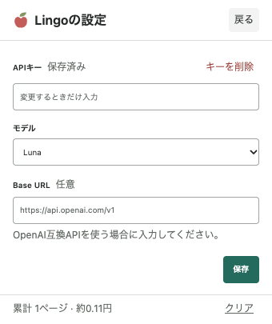

# 操作マニュアル

[Chromeに読み込んだLingo](../../README.md)をツールバーから開き、APIキーと翻訳に使うモデルを設定します。

| 設定     | 入力と保存                                                                                        |
| -------- | ------------------------------------------------------------------------------------------------- |
| APIキー  | 初回に入力して保存。次回は空欄で保存済みキーを維持。「キーを削除」で端末から消去                  |
| モデル   | 初期値は「推奨・高速で低価格」。推奨の更新に自動で追従。特定のモデル名を選ぶと固定                |
| Base URL | 空欄なら https://api.openai.com/v1 。指定時はAPIルートまでを入力。拡張が /chat/completions を付加 |

以前のバージョンで保存したモデルは固定のままです。推奨に切り替えるには、モデル一覧の「推奨・高速で低価格」を選んで保存します。

送信先を変更するときはキーを再入力し、Chromeでホストへの接続を許可します。HTTPSを使用し、localhostと127.0.0.1だけはHTTPにも対応します。

## 原文・対訳・全訳を切り替える

EN（英語）・JA（日本語）・ZH（中国語）から翻訳元と翻訳先を選びます。「原文」は元の文章、「対訳」は原文と訳文、「全訳」は訳文を表示します。翻訳前でも表示モードを選べます。右端の「翻訳」を押すと手動翻訳が始まり、訳文が届いた箇所から選んだモードで表示します。準備中の箇所では原文を読めます。

翻訳済みの段落やリンクにポインターを重ねると、その箇所のりんごが静止した状態で現れます。りんごを押すと「原文」「対訳」「全訳」が並び、選んだ表示をその箇所だけに適用します。キーボードでは Tab でりんごを表示し、Enter またはスペースでメニューを開きます。左右の矢印で選び、Enter で決定、Esc で閉じます。ホバーできないタッチ端末では、訳文が届くとりんごが現れ、そのまま操作できます。ポップアップで表示を選び直すとページ全体がそろいます。

記事一覧など、ラベル全体がリンクなら、対訳・全訳とも元のリンク内に訳文を表示します。文字の大きさ、色、下線、マウスを重ねたときの表示はサイトの指定に従います。文中のリンクは訳文の対応する語句から元のリンク先を開けます。

表のセルでは、長い英単語を含む訳文も列幅に合わせて折り返します。サイトが改行を禁止している著者名や日付は、訳文も一行で表示します。

記事一覧で行全体がリンクになっている場合も、タイトルや説明文にポインターを重ねると、その文章のりんごが現れます。りんごを押すと表示メニューが開き、本文を押すとサイトの記事リンクが開きます。

全訳では元の段落やラベルのフォント、サイズ、太さ、行間、字間、文字色を使います。対訳では本文とボタンの訳文の不透明度を75%にし、本文の訳文を12〜24pxで表示します。原文が20pxまでは75%の大きさを目安にし、大きな見出しほど縮小率を上げます。ボタンとタブでは、ラベルに続けて原文の75%の大きさで訳文を表示します。独立したリンクでは「Business ビジネス向け」のように原文と同じ大きさで続けます。ポップアップを閉じても処理は続きます。

りんごは原文表示では原文のすぐ右、対訳・全訳では訳文のすぐ右に付きます。文章が折り返されても、最後の文字の隣に表示されます。原文では実も葉も緑、対訳では実が赤で葉が緑、全訳では実も葉も赤です。翻訳待ちの段落にポインターを重ねると、原文の末尾でりんごの輪郭がゆっくり明滅し、ポインターを外すと隠れます。訳文が届くと実が塗りつぶされます。端末で動きを減らす設定を使っている場合は、輪郭が静止した状態で現れます。

サイトの自動翻訳は初期状態ではオフです。りんごのアイコンをクリックし、「このサイトを自動翻訳」の右端のスイッチをオンにしてアクセスを許可すると、そのホスト名を端末に保存します。黄緑の葉の下にある実が赤く塗られていればオン、赤い輪郭だけならオフです。オンのサイトでは、ページの読み込み完了時に保存済みの訳文を表示し、残りの本文だけをページタイトルとともにAPIへ送って翻訳します。サブドメインは別のサイトとして扱います。スイッチをオフにするとそのホストを登録から外し、同じサイトのタブを原文に戻します。ログイン中のページも対象になり、API利用料がかかります。

翻訳元と翻訳先はサイトごとに記憶し、初期値は英語から日本語です。反対側と同じ言語を選ぶと翻訳方向が入れ替わります。言語を切り替えると元の訳文を消します。自動翻訳がオンなら新しい言語で翻訳を始めます。APIキーやモデルはポップアップの「設定」から変更します。

ポップアップで選んだ「原文」「対訳」「全訳」はタブを閉じるまで記憶します。リンク移動や再読み込みの後も、原文を選んだタブでは原文を表示します。自動翻訳がオンなら、訳文は裏で準備します。目次や脚注など同じページ内のリンクをたどったときは、進行中の翻訳と取得済みの訳文を引き継ぎます。新しいタブでの自動翻訳は対訳で始まります。

翻訳中に「原文」を選んでも処理は続きます。取得済みの訳文はページ内で再利用でき、表示を切り替えるたびに料金がかかることはありません。処理中は「翻訳中…」と表示され、ボタンは押せません。対象をすべて翻訳するとボタンが「翻訳済み」に変わり、押せなくなります。手動で翻訳したページでも、ポップアップを閉じたあとにスクロールで読み込まれた段落や、クリックで表示された項目を自動で追加翻訳します。保存済みの訳文がある箇所は再利用し、新しくAPIで翻訳した分に料金がかかります。エラーで止まったときや件数上限で省略されたときは、「翻訳」を押すと未翻訳の箇所から再開します。ページを移動した後は古い応答を破棄します。

ヘッダーの「Lingo」の右に、取得済みの訳文数と対象数を `84/323` の形で表示します。開いたメニューや再実行で追加した分も含み、原文表示でも件数を確認できます。

OpenAIの登録済みモデルでは、今のページの翻訳応答から計算した概算料金も円で表示します。単価や使用量が不明な場合は件数だけを表示します。[料金の計算方法](../index.md#概算料金)

設定画面のフッターには、この端末で翻訳した累計ページ数と概算料金を表示します。同じページの追加翻訳はページ数に加えず、再読み込み後に翻訳すると新しい1ページとして数えます。「クリア」を押すと両方がゼロに戻ります。

## 対象と上限

- 通常のHTMLページの見出し・段落・リスト・表セルなどが対象です。言語指定と文字の種類から候補を選びます。中国語は簡体字・繁体字に対応します。言語指定がない漢字だけの日本語は、中国語として選ばれる場合があります。
- 本文とボタンのラベルを文書順に取り出し、1回の操作で最大1,000か所、1か所5,000文字までを翻訳します。残りは再実行できますが、長すぎる単一の段落は次回も省略します。
- 1リクエストは最大12か所・合計10,000文字です。リンクのタグを含めて1段落が10,000文字を超える場合は、その段落の文字だけを翻訳します。1ページにつき最大8リクエストを同時に送り、応答が返った分から元の位置に訳文を表示します。1回の通信は25秒でタイムアウトします。通信切断・タイムアウト・HTTP 408／409／429／5xx の場合、失敗したリクエストだけを最大2回再試行します。待ち時間は1秒、2秒の順で、APIが `Retry-After` を指定した場合はその時間を使います。APIキーや権限のエラーはすぐに表示します。
- iframe、Shadow DOM、PDF、画像内文字、Chromeの内部画面とWeb Storeは対象外です。特殊な入れ子やレイアウトでは一部の原文を拾えないことがあります。

[構成とデータの扱い](../index.md)
