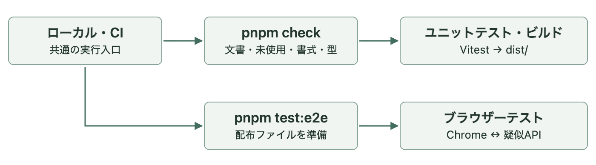

# 開発環境とCI

ローカルとGitHub Actionsは、ルートのpackage.jsonで定義した同じコマンドを実行します。

[初期セットアップ](../../README.md)の後、変更内容に応じて次を使います。

| コマンド                       | 対象・結果                                                                                                          |
| ------------------------------ | ------------------------------------------------------------------------------------------------------------------- |
| pnpm docs:build                | Markdownのタイトル・根拠ファイル・画像・ローカルリンクを確認し、ページ一覧を .cache/docs/index.json に出力          |
| pnpm check:unused              | Knipで未使用ファイル・export・依存を検出。Chromeがファイル名で起動する入口は knip.jsonc に指定                      |
| pnpm lint / pnpm format        | ESLintとPrettierで検査 / Prettierで整形                                                                             |
| pnpm typecheck                 | TypeScriptのcheckJsで拡張のJavaScriptを検査。Chromeの型定義を使用                                                   |
| pnpm test / pnpm test:coverage | Vitestでユニットテスト / V8によるカバレッジを tests/results/coverage に出力                                         |
| pnpm build                     | manifest、実行コード、画面、アイコンを dist にコピー                                                                |
| pnpm test:e2e                  | 配布ファイルをテスト用にコピーし、Playwrightで設定・翻訳・復元・失敗時の動作を確認。画像は tests/results/e2e に保存 |

VS Codeでは推奨拡張のESLint・Prettierを有効にします。整形・型定義はプロジェクトの依存を使います。「タスクの実行」から Lingo: check または Lingo: test:e2e を選べます。

[CI](../../.github/workflows/check.yml) はpushとpull requestで起動します。Ubuntu・macOSでロックファイルから依存を復元して pnpm check を実行し、UbuntuではChromiumを入れてE2Eも実行します。

推奨モデルを変えるときは [models.json](../../models.json) の `recommended` に `models` 内のIDを指定します。各モデルの単価は米ドル／100万トークンです。変更をmainへpushすると[配信用ワークフロー](../../.github/workflows/pages.yml)が拡張と同じ形式チェックを行い、JSONだけを[GitHub Pages](https://uotian.github.io/lingo/models.json)に公開します。同じファイルを拡張のビルドにも含めます。

E2Eは 127.0.0.1:4177 の疑似APIを自分で起動して終了します。既にポートが使われているときは失敗します。個人のキーやChromeプロファイルは不要です。Linuxでブラウザーのシステム依存も必要な場合は `pnpm exec playwright install --with-deps chromium` を使います。

[テストの規約](../../tests/RULES.md) · [拡張の構成](../index.md)
